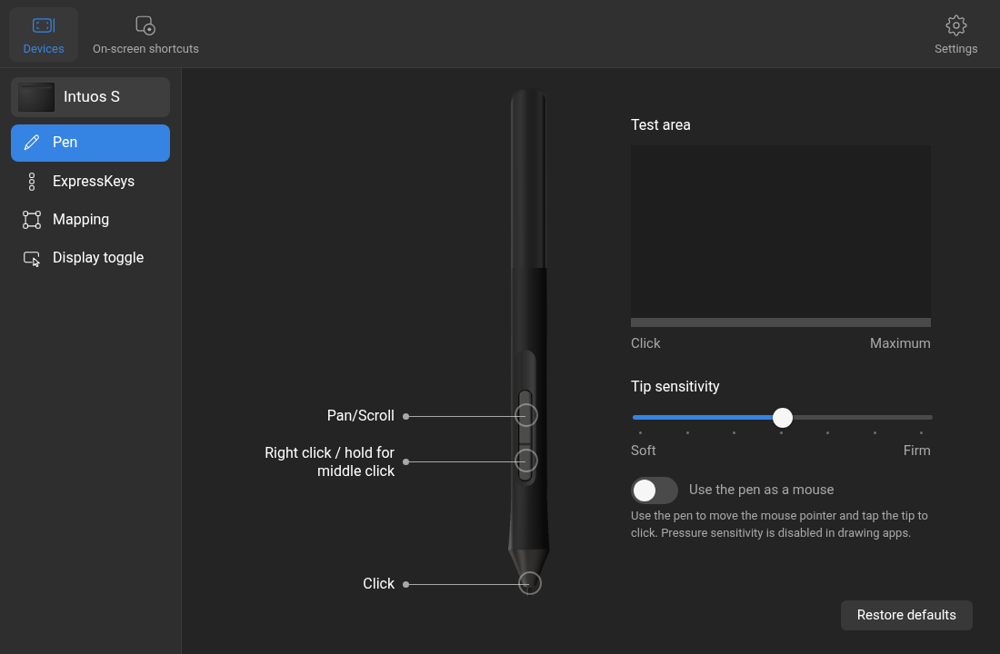

# Tablet Center

A settings app and a small daemon for Wacom pen tablets on GNOME (Wayland).
It adds the features the Linux driver lacks, starting with **pan scroll** as
it works on macOS.

> Unofficial project, not affiliated with or endorsed by Wacom. Wacom,
> Intuos and ExpressKeys are trademarks of Wacom Co., Ltd., used here only
> to say which hardware this works with.



## About this fork

This is a fork of [`wfpaisa/tablet`](https://github.com/wfpaisa/tablet).
Upstream builds from source only; this fork is the one shipping pre-built
binaries for `x86_64` and `aarch64` (cross-compiled in CI) through GitHub
releases. It also rewrites the installer to derive every path from the
XDG/freedesktop spec instead of hardcoding `~/.local` and `~/.config`.
Build-from-source remains available via `scripts/package.sh` for developers
and tinkerers.

## Features

- **Pan scroll**: hold the upper pen button and the cursor freezes; touch the
  tablet and drag to scroll in any direction. Lifting stops at once, with no
  momentum. Five speeds; content can follow the pen or move against it.
- **Pen gestures**: besides Pan/Scroll, the joystick-style Pan/Scroll
  (Legacy), Wheel and Zoom from the macOS driver (the farther you move the
  pen, the faster it goes), vertical-only Scroll, and Pan/Zoom (drag the tip
  to pan, move the pen in the air to zoom). Each has its own speed.
- **On-screen shortcuts**: Express menu and Radial menu (eight slices around
  the pen), App shortcuts (a grid of twelve) and a numeric Keypad, opened
  from a pen button or ExpressKey. Each entry runs a keystroke, click,
  Display toggle or another shortcut.
- **Pen buttons**: any pen gesture or on-screen shortcut, left/right/middle/
  double click, back, forward, Display toggle, or disabled.
- **Tip feel**: seven pressure curves, soft to firm.
- **Mapping**: drive all displays or a single monitor, with optional forced
  proportions. Follows monitor layout changes live.
- **ExpressKeys**: keystrokes (recorded or presets), mouse clicks, pen
  gestures, on-screen shortcuts, Display toggle.
- **Display toggle**: cycle the pen between all displays and each monitor.
- **Settings**: autostart, and backups of your settings to restore later.
- **Two interfaces**, switchable in Settings: *Tablet* (the macOS layout)
  and *Glass*, which draws its own slightly see-through window without the
  system title bar. Both show which pen button or ExpressKey is being
  pressed.
- **Right click, hold for middle**: one pen button gives a right click on a
  tap and a held middle button (to drag, e.g. Super+drag resizes) when held
  or moved. A small GNOME Shell extension, installed by `install.sh`, draws
  a ring next to the cursor while it waits.
- **On-screen shortcuts in GNOME Shell** (Settings): the same extension can
  draw the radial menus and grid panels, so they open at once without a
  window or focus change. Tablet Center's window remains the fallback.
- **Pen as a mouse**: optional single cursor that changes shape over text
  and borders, for when you don't need pressure.
- **14 languages**, English by default.

Tested with an Intuos S (CTL-4100). Other Wacom pens should work; the UI
artwork currently covers the Intuos S only.

## Install

You need GNOME on Wayland (version 48 or later) and an x86_64 or aarch64 PC.
Keep the pen **away from the tablet** while installing, then open a terminal
and paste:

```sh
curl -fsSL https://github.com/mhasanmuammar/tablet/releases/latest/download/install.sh.tar.gz | tar xz && ./install/install.sh
```

The bootstrap downloads `install.sh` plus its packaging, detects your
architecture (`uname -m`), fetches the matching pre-built binary archive
(`tablet-center-x86_64-linux.tar.gz` or `tablet-center-aarch64-linux.tar.gz`)
from this fork's release, and lays everything out under standard XDG
directories — no host Rust toolchain needed.

The installer may ask for your password once, to install WebKitGTK if it is
missing and to give your user access to the tablet. When it finishes,
**log out and back in**, then open **Tablet Center** from the app grid.
If the tablet does nothing after that, restart the computer.

### Download by hand

Get the archive matching your arch from the
[latest release](https://github.com/mhasanmuammar/tablet/releases/latest),
extract it, and run `./install.sh` inside the extracted folder.

### Flatpak bundle (.flatpak)

You can install the standalone Flatpak bundle `com.tabletcenter.TabletCenter.flatpak` available in the [latest release](https://github.com/mhasanmuammar/tablet/releases/latest).

To install:
```sh
flatpak install --user com.tabletcenter.TabletCenter.flatpak
```

To run:
```sh
flatpak run com.tabletcenter.TabletCenter
```

> **Host integration:** When launched inside Flatpak, Tablet Center includes a host integration helper that sets up the GNOME Shell extension, systemd user service for `tabletd`, and udev permissions on your host.

### Uninstall

```sh
./install/uninstall.sh           # keeps your settings
./install/uninstall.sh --purge   # deletes settings and backups too
```

## Build from source

Build-from-source is for developers and tinkerers; normal users should use
the pre-built install above.

Install Rust (stable) and the
[Tauri 2 Linux prerequisites](https://v2.tauri.app/start/prerequisites/#linux),
then run `install.sh` from a checkout. It uses
`dist/tablet-center-<arch>-linux.tar.gz` when present, otherwise downloads
the matching pre-built archive from GitHub:

```sh
./install.sh
```

To build and package the release archive yourself:

```sh
scripts/package.sh              # x86_64 native build
scripts/package.sh aarch64      # cross-compile for aarch64
```

The archive lands in `dist/tablet-center-<arch>-linux.tar.gz`.

### Container build

Building needs the Tauri Linux prerequisites (WebKitGTK 4.1, gtk, librsvg,
pkg-config) and Rust. `scripts/container.sh` runs everything inside a
container so the host never has to install them. podman is preferred; docker
is used when podman is missing.

```sh
scripts/container.sh build      # build the toolchain image
scripts/container.sh test      # run cargo test --workspace
scripts/container.sh release    # build + package the release archive
scripts/container.sh shell     # interactive shell in the image
```

The release archive lands in `dist/tablet-center-<arch>-linux.tar.gz`. The
image also ships a small runtime stage (`tablet-center:final`) with the
binaries and their shared libraries under `/output/bin/`, plus the archive in
`/output/`.

### Flatpak build

To build the Flatpak application and create a standalone `.flatpak` bundle locally:

```sh
# Build and export to a local repository
flatpak-builder --user --install-deps-from=flathub --force-clean --repo=repo build-dir packaging/flatpak/com.tabletcenter.TabletCenter.yml

# Create single-file bundle
flatpak build-bundle --runtime-repo=https://dl.flathub.org/repo/flathub.flatpakrepo repo com.tabletcenter.TabletCenter.flatpak com.tabletcenter.TabletCenter stable
```

## Guide

### Install from source

Install Rust (stable) and the Tauri 2 Linux prerequisites, then:

```sh
./install.sh
```

### Check status

```sh
systemctl --user status tabletd
```

### Develop

```sh
./dev.sh            # UI only; talks to the installed service
./dev.sh --daemon   # also runs a local tabletd build if the service is stopped
cargo test
```

The window loads `ui/` from a local server, so UI edits show up with
Ctrl+R without rebuilding.

### Troubleshooting

- **Tablet does nothing after install:** log out and back in (GNOME Shell
  loads the extension then). If it still does nothing, restart the computer.
- **Added to the `input` group:** you must log out and back in for group
  membership to take effect.
- **Extension not loaded:** log out and back in once so GNOME Shell loads the
  extension.
- **Unsupported architecture:** only x86_64 and aarch64 pre-built archives
  are shipped. riscv64 (and other) owners build from source with
  `scripts/package.sh`.

**Careful when changing `tabletd`.** gnome-shell (Mutter 51) crashes if a
virtual tablet disappears, or the tablet changes owner, while the pen is in
proximity, and that ends your session. The daemon avoids this by releasing
everything before removing its devices, grabbing the tablet only while the pen
is away, and never reusing the real pen's serial. Keep those guarantees when
you change it, and stop the daemon with SIGTERM, never SIGKILL.

## Details

The installer puts everything under your home folder: `tabletd` as a
systemd user service that starts with your session, the Tablet Center app
in the app grid, and its GNOME Shell extension. Only the system part needs
your password: WebKitGTK 4.1 when it is missing, a udev rule for
`/dev/uinput`, and membership in the `input` group. Check the service with
`systemctl --user status tabletd`.

GNOME is required because the daemon reads the monitor layout from Mutter;
other desktops are not supported (contributions welcome).

## How it works

```
tablet ──> tabletd ──> virtual pen, pointer and keyboard (uinput) ──> GNOME
              ^
              └── settings + live status (Unix socket) ── Tablet Center (Tauri)
```

- **`tabletd`** (`crates/tabletd`) takes exclusive control of the tablet,
  applies your settings and re-emits the result through virtual devices.
  Scrolling and clicks go through a separate absolute pointer, because GNOME
  gives a tablet tool its own cursor.
- **Tablet Center** (`crates/tablet-center`, `ui`) is a Tauri app with
  a plain HTML/CSS/JS front end. It writes
  `~/.config/tablet-center/config.json` and tells the daemon to reload over
  `$XDG_RUNTIME_DIR/tabletd.sock`.
- **`tablet-config`** (`crates/tablet-config`) holds the settings and the
  socket protocol shared by both.

## Credits

- Font: [Roboto](https://github.com/googlefonts/roboto-classic) via
  Fontsource (SIL Open Font License, `ui/assets/fonts/OFL.txt`).
- App icon: drawn for this project.

## License

GPL-3.0-or-later. See [LICENSE](LICENSE).
